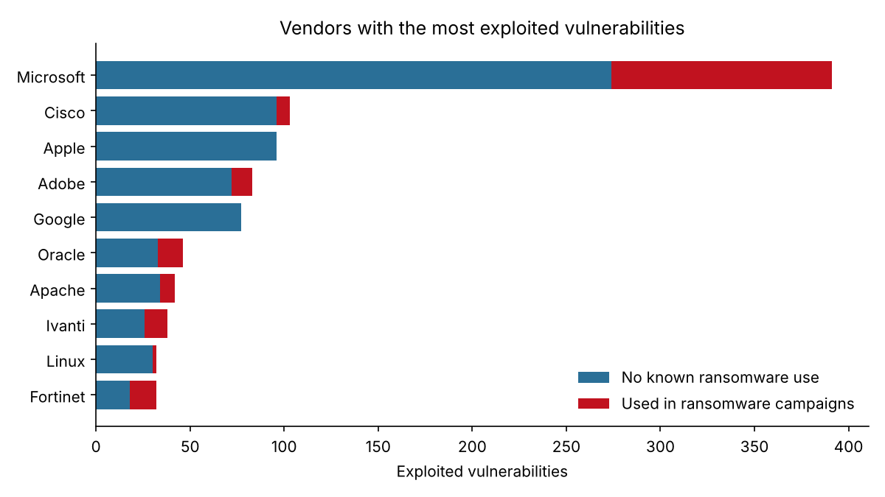
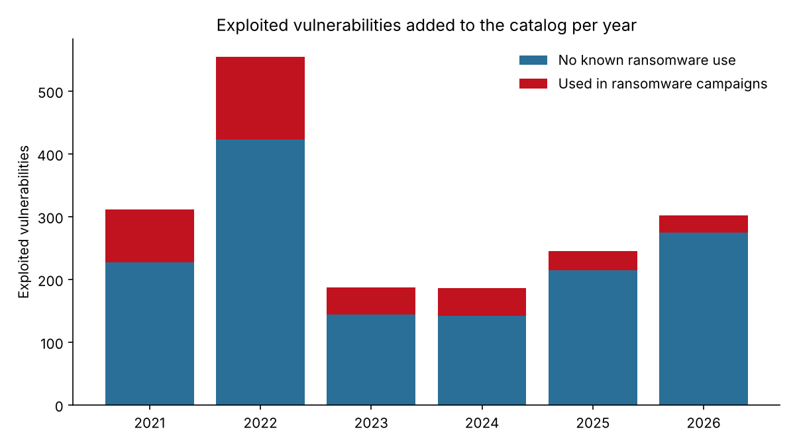

# KEV Tracker

A small data pipeline that tracks the vulnerabilities attackers are exploiting right now, and shows which software in an inventory to review first.

It uses the [CISA Known Exploited Vulnerabilities (KEV) catalog](https://www.cisa.gov/known-exploited-vulnerabilities-catalog), the US government's public list of flaws with confirmed real-world attacks. The catalog changes every week, so each run works on current data.

## Why I built it

Most organizations have more open vulnerabilities than they can patch. The KEV catalog answers a narrower question: which flaws are being used in real attacks? I wanted a tool that downloads the list, checks it, stores it in a database I can query with SQL, and turns it into a short report and a ranked review list.

## What it does

1. **Download** the current catalog as JSON (`src/fetch.py`).
2. **Clean and load** it into SQLite (`src/load.py`). It checks for duplicate CVE IDs and compares the loaded row count with the count CISA reports. Weakness types (CWEs) go in their own table because one CVE can have several.
3. **Analyze** it with SQL (`sql/analysis.sql`): totals, top vendors, entries per year, top weakness types, how old each flaw was when it was added, and a window-function query that ranks vendors within each year.
4. **Report** the results as charts and a Markdown summary (`src/report.py`).
5. **Check an inventory** (`src/check_inventory.py`): match a CSV of vendor and product names against the catalog and rank the products, ransomware-linked flaws first.

## What the data shows

Snapshot from catalog version 2026.11.18. Full tables are in [reports/summary.md](reports/summary.md).

- **1,786** vulnerabilities have confirmed real-world exploitation.
- **361** of them (20.2%) have been used in ransomware campaigns.
- **Microsoft** has the most entries (391), followed by Cisco (103) and Apple (96).
- **21%** were already five or more years old when CISA added them. Old flaws that never got patched still get attacked.
- Fortinet and Ivanti have fewer entries than the largest vendors, but a much higher share linked to ransomware (14 of 32 and 12 of 38).





### Inventory check

Run against the sample inventory in `data/sample_inventory.csv` (a made-up list of ten common products):

| vendor | product | KEV entries | linked to ransomware |
|---|---|---:|---:|
| Microsoft | Windows | 178 | 49 |
| Microsoft | Exchange Server | 17 | 13 |
| Fortinet | FortiOS | 15 | 12 |
| Ivanti | Connect Secure | 16 | 8 |
| Atlassian | Confluence | 9 | 7 |
| VMware | vCenter Server | 10 | 3 |
| Apache | Tomcat | 6 | 1 |
| Google | Chromium | 66 | 0 |
| Cisco | IOS XE | 26 | 0 |
| Zoom | Zoom Client | 0 | 0 |

## How to run it

```bash
pip install -r requirements.txt
python run.py                                   # download, load, report, inventory check
python src/check_inventory.py my_inventory.csv  # your own list: columns vendor, product, owner
pytest                                          # tests use a small made-up catalog, no internet needed
```

## Limits

- **The inventory match uses names, not versions.** A match means "review this product", not "this system is vulnerable". A fuller version would match on CPE identifiers and installed versions.
- **The name match is simple.** It needs the vendor to match exactly and the product name to appear in the catalog's product field, so unusual spellings are missed.
- **"Unknown" ransomware use is not "none".** CISA only marks ransomware use when it is confirmed.
- **The catalog is a floor.** It lists flaws CISA has confirmed as exploited. Other flaws are exploited too.

## What I would add next

- EPSS scores (the probability a flaw will be exploited) and CVSS severity from the NVD API, to rank the review list better.
- A scheduled run that refreshes the report when the catalog changes.
- Version-aware matching with CPE.

## Tools

Python, pandas, SQLite, SQL, matplotlib, pytest.

## Data source

CISA Known Exploited Vulnerabilities catalog, public domain, from the [cisagov/kev-data](https://github.com/cisagov/kev-data) repository.
