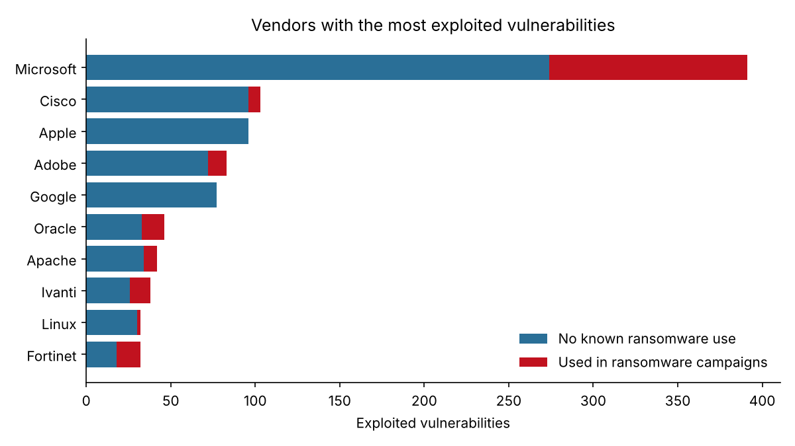
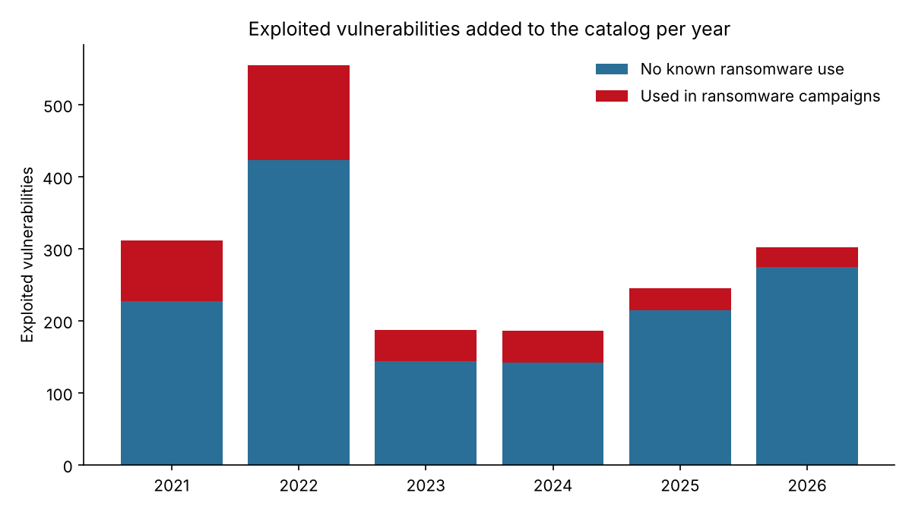

# KEV Tracker summary

Catalog version 2026.11.18 (released 2026-11-18).

## Key numbers

- **1,786** vulnerabilities are known to be exploited in real attacks.
- **361** of them (20.2%) have been used in ransomware campaigns.
- **Microsoft** has the most entries: 391.
- **21%** were already 5 or more years old when they were added, so old unpatched flaws still get attacked.
- **38** were added in the 30 days up to 2026-11-18.

## Top 10 vendors

| vendor    |   cves |   ransomware_cves |
|:----------|-------:|------------------:|
| Microsoft |    391 |               117 |
| Cisco     |    103 |                 7 |
| Apple     |     96 |                 0 |
| Adobe     |     83 |                11 |
| Google    |     77 |                 0 |
| Oracle    |     46 |                13 |
| Apache    |     42 |                 8 |
| Ivanti    |     38 |                12 |
| Linux     |     32 |                 2 |
| Fortinet  |     32 |                14 |

## Added per year

|   year_added |   cves |   ransomware_cves |
|-------------:|-------:|------------------:|
|         2021 |    311 |                84 |
|         2022 |    555 |               132 |
|         2023 |    187 |                43 |
|         2024 |    186 |                44 |
|         2025 |    245 |                31 |
|         2026 |    302 |                27 |

## Top 10 weakness types (CWE)

| cwe     |   cves |   ransomware_cves |
|:--------|-------:|------------------:|
| CWE-20  |    119 |                26 |
| CWE-78  |    115 |                12 |
| CWE-787 |    106 |                16 |
| CWE-416 |     96 |                10 |
| CWE-119 |     88 |                 9 |
| CWE-22  |     82 |                27 |
| CWE-94  |     74 |                11 |
| CWE-502 |     72 |                29 |
| CWE-287 |     50 |                16 |
| CWE-306 |     43 |                13 |

## Age of the flaw when it was added

| age_when_added   |   cves |
|:-----------------|-------:|
| 0 (same year)    |    812 |
| 1 year           |    275 |
| 2-4 years        |    326 |
| 5+ years         |    373 |

## Added in the last 30 days

| cve_id          | vendor                     | product                                                    | date_added   | due_date   |   ransomware |
|:----------------|:---------------------------|:-----------------------------------------------------------|:-------------|:-----------|-------------:|
| CVE-2024-10441  | Synology                   | DiskStation Manager (DSM)                                  | 2026-11-18   | 2026-11-21 |            0 |
| CVE-2026-40217  | BerriAI                    | LiteLLM                                                    | 2026-11-18   | 2026-12-02 |            0 |
| CVE-2026-90436  | Apache                     | Axis                                                       | 2026-11-18   | 2026-11-21 |            0 |
| CVE-2026-90817  | Vanderbilt University      | Research Electronic Data Capture (REDCap)                  | 2026-11-18   | 2026-11-21 |            0 |
| CVE-2026-115731 | Perforce                   | Puppet Enterprise                                          | 2026-11-17   | 2026-12-01 |            0 |
| CVE-2026-114713 | UnrealIRCd                 | UnrealIRCd                                                 | 2026-11-13   | 2026-11-16 |            0 |
| CVE-2026-123039 | Check Point                | Multiple Products                                          | 2026-11-13   | 2026-11-16 |            0 |
| CVE-2026-111560 | Barracuda Networks         | Multiple Products                                          | 2026-11-10   | 2026-11-13 |            0 |
| CVE-2026-111793 | Openwave Messaging Limited | Webtop Media Transcoder                                    | 2026-11-10   | 2026-11-24 |            0 |
| CVE-2026-116606 | Barracuda Networks         | Barracuda Email Security Gateway (ESG)                     | 2026-11-10   | 2026-11-13 |            0 |
| CVE-2026-124194 | Microsoft                  | Office                                                     | 2026-11-10   | 2026-11-24 |            0 |
| CVE-2026-125350 | Google                     | Chromium                                                   | 2026-11-10   | 2026-11-24 |            0 |
| CVE-2026-20320  | Cisco                      | BroadWorks                                                 | 2026-11-10   | 2026-11-24 |            0 |
| CVE-2026-102895 | GPUStack                   | GPUStack                                                   | 2026-11-09   | 2026-11-12 |            0 |
| CVE-2026-116779 | SignalWire                 | FreeSwitch                                                 | 2026-11-09   | 2026-11-12 |            0 |
| CVE-2026-123158 | OpenBSD                    | OpenSSH                                                    | 2026-11-09   | 2026-11-12 |            0 |
| CVE-2026-123218 | IBM                        | Aspera Faspex                                              | 2026-11-09   | 2026-11-12 |            0 |
| CVE-2026-19868  | SonicWall                  | SonicOS SSLVPN                                             | 2026-11-06   | 2026-11-20 |            0 |
| CVE-2024-27834  | Apple                      | Multiple Products                                          | 2026-11-04   | 2026-11-18 |            0 |
| CVE-2026-119977 | WordPress                  | WordPress Core                                             | 2026-11-03   | 2026-11-06 |            0 |
| CVE-2026-111357 | Ivanti                     | Connect Secure                                             | 2026-10-30   | 2026-11-02 |            0 |
| CVE-2026-118527 | Ivanti                     | Connect Secure                                             | 2026-10-30   | 2026-11-13 |            0 |
| CVE-2026-76418  | Cisco                      | Secure Firewall ASA Software and Cisco Secure FTD Software | 2026-10-29   | 2026-11-01 |            0 |
| CVE-2026-97229  | GitLab                     | Community Edition and Enterprise Edition                   | 2026-10-29   | 2026-11-01 |            0 |
| CVE-2026-41709  | Broadcom                   | VMware ESX                                                 | 2026-10-28   | 2026-11-11 |            0 |
| CVE-2026-46300  | Linux                      | Kernel                                                     | 2026-10-28   | 2026-10-31 |            0 |
| CVE-2026-111497 | Google                     | Brotli                                                     | 2026-10-27   | 2026-11-10 |            0 |
| CVE-2026-48356  | Adobe                      | Commerce and Magento                                       | 2026-10-27   | 2026-11-10 |            0 |
| CVE-2026-109618 | PHP Group                  | PHP                                                        | 2026-10-26   | 2026-10-29 |            0 |
| CVE-2026-109619 | PHP Group                  | PHP                                                        | 2026-10-26   | 2026-10-29 |            0 |
| CVE-2026-110447 | Collabora                  | Collabora Online – Built-in CODE Server                    | 2026-10-23   | 2026-10-26 |            0 |
| CVE-2026-114625 | Arista                     | VeloCloud Orchestrator                                     | 2026-10-23   | 2026-10-26 |            0 |
| CVE-2026-106931 | EG Secure Solutions        | SiteGuard Server Edition                                   | 2026-10-20   | 2026-10-23 |            0 |
| CVE-2026-110936 | Siemens                    | Software Center                                            | 2026-10-20   | 2026-11-03 |            0 |
| CVE-2026-96652  | Plex                       | Media Server                                               | 2026-10-20   | 2026-11-03 |            0 |
| CVE-2026-96654  | Plex                       | Media Server                                               | 2026-10-20   | 2026-10-23 |            0 |
| CVE-2026-96655  | Plex                       | Media Server                                               | 2026-10-20   | 2026-11-03 |            0 |
| CVE-2026-96656  | Plex                       | Media Server                                               | 2026-10-20   | 2026-10-23 |            0 |
